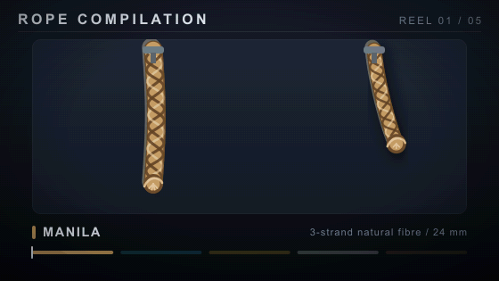

# Rope compilation

An animated GIF reel of five different ropes, generated from scratch — no
external assets and no new npm dependencies.



## What's in it

| Reel | Rope | Spec | Motion |
| --- | --- | --- | --- |
| 01 | Manila | 3-strand natural fibre / 24 mm | Two lines swinging from eye bolts, with frayed ends |
| 02 | Nylon kernmantle | single rope / 10.5 mm | A braided line draped from an eye bolt to a carabiner, plus a hung bight |
| 03 | Shock cord | elastic bungee / 8 mm | Two cords stretching and recoiling, with travelling bands |
| 04 | Dock line | braided polyester / 16 mm | A catenary span between two bollards, swaying under a shackle |
| 05 | Tarred hemp | coiled hank / 18 mm | A coil turning on a bench with its working end trailing off |

560 × 315, 120 frames, 12.5 fps, 9.6 s, looping forever.

## How it is made

- **Frames** — `lib/render.mjs` builds each frame as an SVG string and hands it
  to `sharp` (librsvg), which rasterises it to raw RGB. Ropes are drawn as a
  centre line plus helical strands whose lateral offset follows a sine wave in
  *arc length*; that is what makes them read as laid, twisted rope rather than
  a plain tube. Lighting comes from a lit and a shaded crescent masked to the
  rope silhouette, so each rope reads as round.
- **Transition** — the outgoing clip slides up out of a window while the next
  slides in from below, so two scenes are never on screen at once.
- **Encoding** — `lib/gif.mjs` is a self-contained GIF89a encoder: a
  median-cut global palette over all 120 frames, ordered Bayer dithering
  applied only to the dark backdrop (where quantisation would otherwise band),
  and LZW compression with a NETSCAPE2.0 infinite-loop extension.

## Rebuilding

```sh
node build.mjs          # writes rope-compilation.gif
node build.mjs --preview # also writes preview.png, a contact sheet
node verify.mjs         # re-parses and decodes the GIF, then compares it
```

`verify.mjs` parses the GIF's raw block structure and then decodes every frame
with libvips — an independent decoder — comparing each against a fresh render
of the same frame, so a broken encoder cannot pass silently. It should report
a mean absolute error of about 2/255, which is quantisation noise alone.
